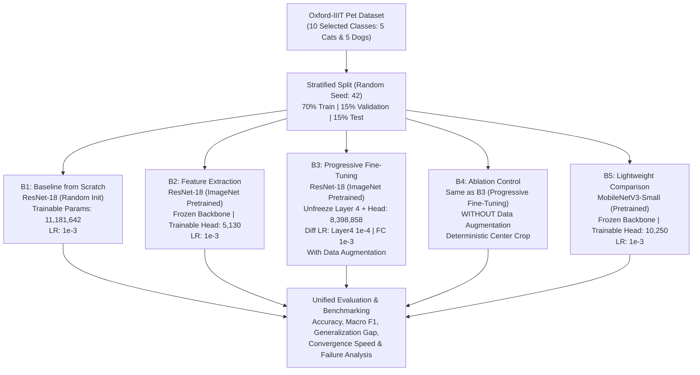
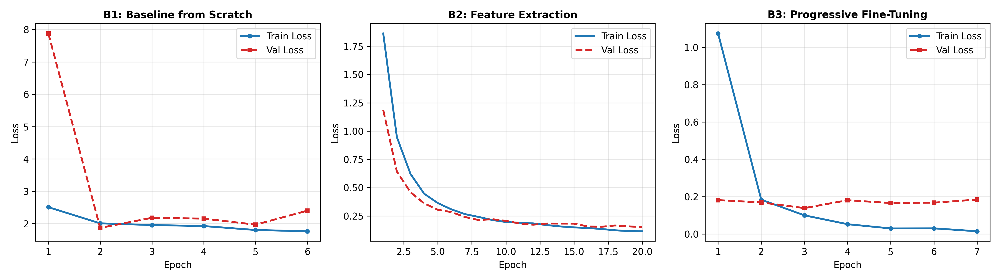
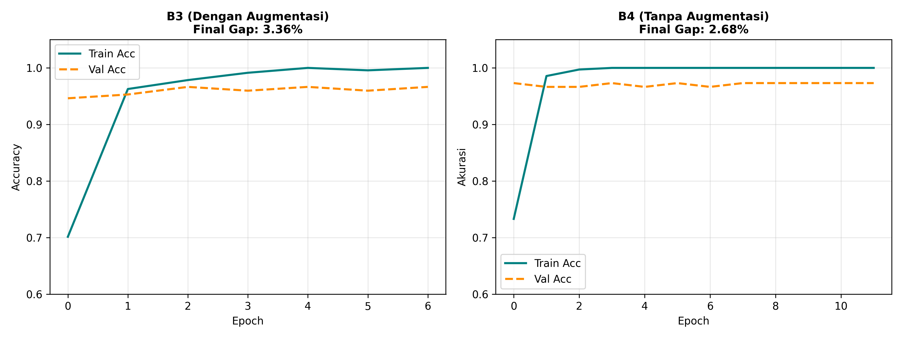
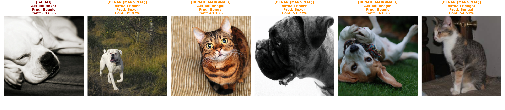

# Deep Learning: Empirical Study on Transfer Learning & Progressive Fine-Tuning

[](https://www.python.org/)
[](https://pytorch.org/)
[](https://pytorch.org/)
[](https://scikit-learn.org/)
[](LICENSE)

An empirical comparative study investigating transfer learning paradigms, inductive bias, progressive layer unfreezing, and data augmentation dynamics using Deep Convolutional Neural Networks (**ResNet-18** & **MobileNetV3-Small**) on a 10-breed subset of the **Oxford-IIIT Pet Dataset**.

---

## Author & Academic Information
- **Name:** Edwin Antonie
- **Student ID (NIM):** 2802397306
- **Course:** Deep Learning (LEC) — Class LB01
- **Institution:** Computer Science / Artificial Intelligence Program

---

## Table of Contents
1. [Project Overview](#project-overview)
2. [Dataset & Target Classes](#dataset--target-classes)
3. [Experimental Methodology](#experimental-methodology)
4. [Benchmark Results](#benchmark-results)
5. [Visual Analysis & Discussion](#visual-analysis--discussion)
   - [Loss Curves & Optimization Dynamics](#1-loss-curves--optimization-dynamics-c1)
   - [Generalization Gap & Overfitting](#2-generalization-gap--data-augmentation-ablation-c2)
   - [Failure Analysis & Boundary Cases](#3-failure-analysis--high-uncertainty-samples-c3)
6. [Architectural Comparison: ResNet-18 vs MobileNetV3-Small](#architectural-comparison-resnet-18-vs-mobilenetv3-small)
7. [Repository Structure](#repository-structure)
8. [Getting Started & Reproduction](#getting-started--reproduction)
9. [Key Theoretical Insights](#key-theoretical-insights)

---

## Project Overview

When training deep neural networks on specialized visual domains with limited data, practitioners face critical architectural trade-offs:
- **Training from Scratch vs Transfer Learning:** Does training a 11M-parameter model from random initialization risk severe underfitting and optimization degradation?
- **Feature Extraction vs Progressive Fine-Tuning:** Is freezing the entire feature extractor sufficient, or does differential unfreezing of deep residual blocks yield superior domain adaptation?
- **Data Augmentation Necessity:** Does aggressive data augmentation always improve generalization when target images closely match pre-training distribution (ImageNet-1K)?
- **Model Efficiency:** How does a lightweight, mobile-optimized architecture (**MobileNetV3-Small**) perform compared to standard residual architectures (**ResNet-18**)?

This repository systematically benchmarks these questions under controlled empirical protocols (strictly stratified splits, fixed seed `42`, identical validation patience, and unified evaluation metrics).



---

## Dataset & Target Classes

The study evaluates on a balanced 10-breed subset of the **Oxford-IIIT Pet Dataset**, spanning fine-grained intra-species and inter-species classification:

| Index | Category | Breed Name | Sample Representation |
|:---:|:---:|:---|:---|
| **0** | Cat | **Abyssinian** | Agouti-ticked coat, slender build |
| **1** | Cat | **Bengal** | Distinct rosetted / leopard-like patterns |
| **2** | Cat | **Birman** | Pointed color pattern, white paws ("gloves") |
| **3** | Cat | **Bombay** | Solid black coat, copper/gold eyes |
| **4** | Cat | **British Shorthair** | Dense coat, round face, compact body |
| **5** | Dog | **Beagle** | Tri-color hound markings, drooping ears |
| **6** | Dog | **Boxer** | Muscular build, brachycephalic snout |
| **7** | Dog | **Chihuahua** | Small scale, apple/deer-head morphology |
| **8** | Dog | **Pug** | Wrinkled short-muzzled face, curled tail |
| **9** | Dog | **Samoyed** | Dense white double coat, spitz characteristics |

- **Partitioning:** Stratified random split preserving class balance:
  - **Train:** 70% (~1,386 samples)
  - **Validation:** 15% (~298 samples)
  - **Test:** 15% (~298 samples)

---

## Experimental Methodology

All models were evaluated under strict experimental controls:
- **Reproducibility Protocol:** Universal seed (`42`) seeded across `random`, `numpy`, `torch.manual_seed`, `torch.cuda.manual_seed_all`, and deterministic CUDNN flags (`torch.backends.cudnn.deterministic = True`).
- **Loss Function:** `nn.CrossEntropyLoss()`
- **Optimizer:** `torch.optim.Adam`
- **Early Stopping:** `patience = 4` monitoring validation loss to prevent unnecessary overfitting.
- **Image Input Resolution:** $224 \times 224$ pixels normalized with ImageNet statistics ($\mu = [0.485, 0.456, 0.406]$, $\sigma = [0.229, 0.224, 0.225]$).

---

## Benchmark Results

The table below summarizes the quantitative performance across all five experimental conditions:

| Code | Experimental Condition | Backbone | Trainable Params | Learning Rate | Optimal Epoch | Duration (s) | Val Accuracy | Test Macro F1 | Test Accuracy |
|:---:|:---|:---:|:---:|:---:|:---:|:---:|:---:|:---:|:---:|
| **B1** | Baseline from Scratch | ResNet-18 | 11,181,642 | $10^{-3}$ | 6 | 11.89s | 32.89% | 0.2870 | **36.00%** |
| **B2** | Feature Extraction | ResNet-18 | 5,130 | $10^{-3}$ | 20 | 29.49s | 95.30% | 0.9733 | **97.33%** |
| **B3** | Progressive Fine-Tuning (Aug) | ResNet-18 | 8,398,858 | `layer4`: $10^{-4}$<br>`fc`: $10^{-3}$ | 7 | 10.35s | 96.64% | 0.9733 | **97.33%** |
| **B4** | Ablation Control (No Aug) | ResNet-18 | 8,398,858 | `layer4`: $10^{-4}$<br>`fc`: $10^{-3}$ | 12 | 13.05s | 97.32% | **0.9933** | **99.33%** |
| **B5** | MobileNetV3-Small (Bonus) | MobileNetV3-S | 10,250 | $10^{-3}$ | 14 | 20.75s | 92.62% | 0.9460 | **94.67%** |

---

## Visual Analysis & Discussion

### 1. Loss Curves & Optimization Dynamics (C1)



- **B1 (Scratch):** Suffers from severe optimization degradation. The validation loss diverges early ($>7.0$), indicating that 1,386 training samples are completely inadequate to calibrate 11.18 million parameters without pre-existing priors.
- **B2 (Feature Extraction):** Demonstrates stable, asymptotic loss descent. Because the backbone is frozen, gradients only modify the 5,130 parameters in the linear classification head, preventing catastrophic forgetting.
- **B3 (Progressive Fine-Tuning):** Achieves rapid convergence in just **7 epochs** (compared to 20 epochs for B2). Unfreezing `layer4` with a lower learning rate ($10^{-4}$) allows high-level visual representations to adapt to pet anatomy without disrupting foundational low-level filters.

---

### 2. Generalization Gap & Data Augmentation Ablation (C2)



- **Performance Leap (+61.33%):** Moving from random initialization (B1: 36.00%) to transfer learning (B2: 97.33%) produces an overwhelming gain, demonstrating the immense value of ImageNet visual priors.
- **Convergence Acceleration (13 Epochs Faster):** B3 achieves parity with B2 in just 7 epochs versus 20 epochs.
- **The Data Augmentation Paradox (B3 vs B4):**
  - **B3 (With Augmentation):** Test Accuracy = 97.33%, Macro F1 = 0.9733, Generalization Gap = 3.36%.
  - **B4 (Without Augmentation):** Test Accuracy = **99.33%**, Macro F1 = **0.9933**, Generalization Gap = **2.68%**.
  - *Theoretical Explanation:* Oxford-IIIT Pet is a clean dataset where subjects are already centered, and ImageNet-1K already contains abundant domestic canine and feline representations. Severe stochastic cropping and color perturbations in B3 injected unnecessary noise into already aligned features, whereas deterministic center cropping (B4) preserved structural fidelity.

---

### 3. Failure Analysis & High-Uncertainty Samples (C3)



A qualitative inspection of test predictions using the best checkpoint (B4) revealed:
- **Total Misclassifications:** Only **1 out of 298 samples** was misclassified (**99.33% accuracy**).
  - *Misclassified Case:* An atypical Boxer instance was mispredicted as Beagle (68.63% confidence) due to visual ambiguity, ear posture, and lighting conditions resembling hound facial geometries.
- **High Uncertainty / Marginal Boundary Cases:**
  - Bengal cats with extreme close-ups or unusual lighting where coat rosettes appeared subdued (confidence ~48–54%).
  - Boxer dogs with partial head occlusions or unusual camera angles where snout flatness was less pronounced.

---

## Architectural Comparison: ResNet-18 vs MobileNetV3-Small

| Metric / Aspect | ResNet-18 (B2 / B3) | MobileNetV3-Small (B5) | Trade-Off & Practical Assessment |
|:---|:---:|:---:|:---|
| **Classification Test Accuracy** | **97.33% – 99.33%** | 94.67% | ResNet maintains a slight edge (~2.6%–4.6%) on subtle breed features |
| **Trainable Head Parameters** | 5,130 | 10,250 | MobileNet's two-layer classifier has slightly higher head parameter count |
| **Total Model Footprint** | ~45 MB | **~10 MB** | MobileNet delivers a **4.5× reduction** in model weight size |
| **Inference Efficiency & FLOPs** | ~1.8 GFLOPs | **~0.06 GFLOPs** | MobileNet is **~30× more computationally efficient** for edge deployment |
| **Target Deployment Scenario** | Server-side / High Accuracy | On-device Mobile / Embedded IoT | MobileNetV3-Small is ideal for low-power edge applications |

---

## Repository Structure

```
Tugas05_2802397306_EdwinAntonie/
├── .gitignore                                      # Excludes cache, checkpoints, and temp files
├── README.md                                       # Comprehensive documentation and benchmark analysis
├── requirements.txt                                # Python dependencies for local and Colab environments
├── Tugas05_Notebook_2802397306_EdwinAntonie.ipynb  # End-to-end Jupyter Notebook with full experiment runs
├── Tugas05_LogHasilMentah_2802397306_EdwinAntonie.csv # Raw quantitative benchmark metrics export
├── Tugas05_Laporan_2802397306_EdwinAntonie.pdf    # Formal academic laboratory report (PDF)
├── Tugas05_BagianA_2802397306_EdwinAntonie.pdf    # Theoretical assignment answers (Part A - PDF)
└── image/                                          # High-resolution benchmark figures
    ├── c1_loss_curves_comparison.png               # Loss curves for B1, B2, and B3
    ├── c2_accuracy_gap_analysis.png                # Accuracy and generalization gap comparison
    └── c3_failure_analysis.png                     # Qualitative error and boundary analysis visualization
```

---

## Getting Started & Reproduction

### Prerequisites
- Python 3.10 or higher
- NVIDIA CUDA-capable GPU recommended (automatically falls back to CPU if unavailable)

### 1. Clone the Repository
```bash
git clone https://github.com/EdwinAntoniee/Tugas05_2802397306_EdwinAntonie.git
cd Tugas05_2802397306_EdwinAntonie
```

### 2. Set Up Virtual Environment
```bash
# Windows (PowerShell)
python -m venv venv
.\venv\Scripts\Activate.ps1

# Linux / macOS
python3 -m venv venv
source venv/bin/activate
```

### 3. Install Dependencies
```bash
pip install -r requirements.txt
```

### 4. Execute the Experiments
Launch the Jupyter Notebook interface:
```bash
jupyter notebook Tugas05_Notebook_2802397306_EdwinAntonie.ipynb
```
The notebook automatically downloads the Oxford-IIIT Pet dataset via `torchvision.datasets.OxfordIIITPet`, sets seeds, executes all five training conditions, generates comparison plots, and exports the raw benchmark CSV.

---

## Key Theoretical Insights

1. **Batch Normalization Regularization Dynamics:**
   - Mini-batch statistics inject stochastic noise that regularizes representations similar to Dropout.
   - Extremely small batch sizes ($m \le 4$) degrade estimation stability, whereas very large batches ($m \ge 512$) diminish stochastic noise, necessitating explicit dropout.
2. **The Degradation Problem & Residual Learning:**
   - Plain deep networks suffer from optimization bottlenecks where adding depth increases training error despite having capacity.
   - ResNet bypasses this via identity shortcut connections ($H(x) = F(x) + x$), enabling gradients to propagate directly through residual pathways.
3. **Differential Learning Rates in Transfer Learning:**
   - Lower learning rates on unfreezed residual blocks ($10^{-4}$) protect pre-trained features from catastrophic distortion while allowing specialized adaptation to the target domain.

---

## License
This project is open-source under the [MIT License](LICENSE).
